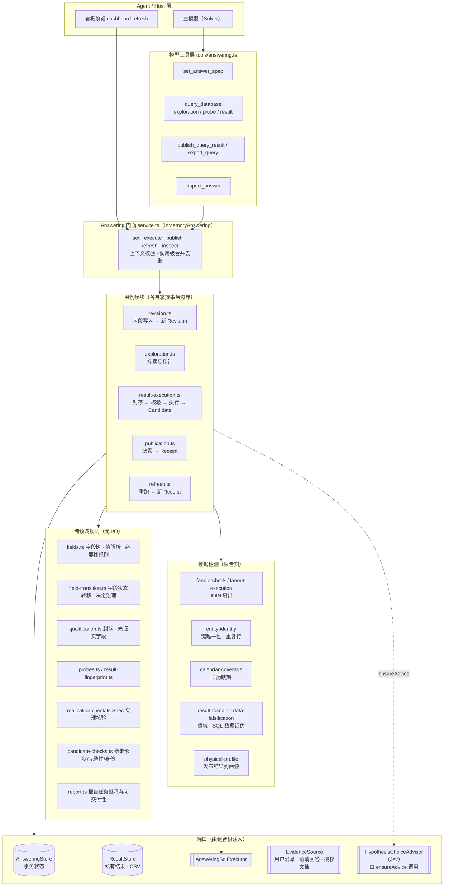
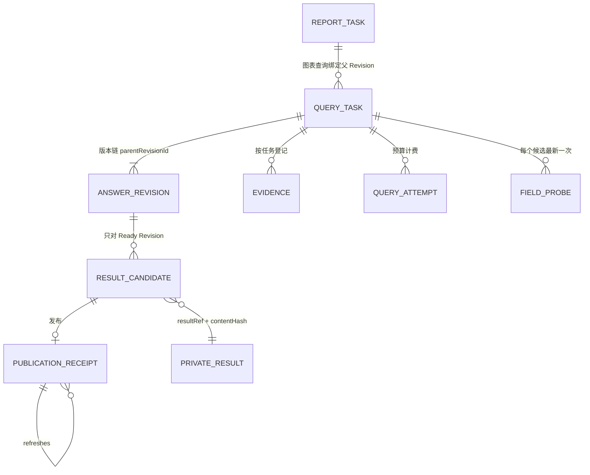
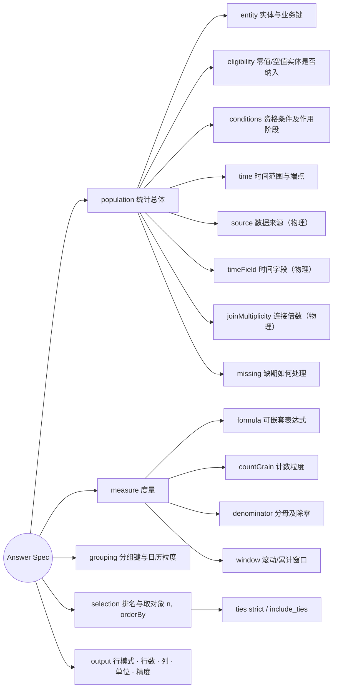
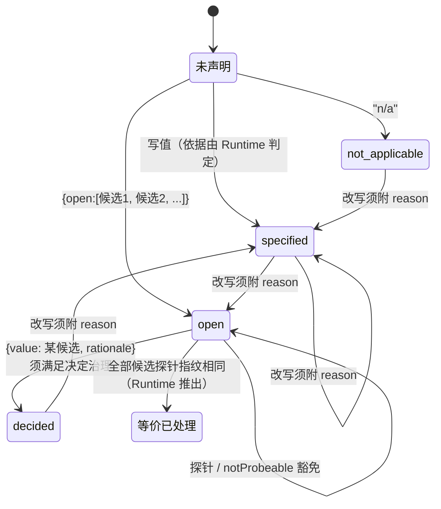
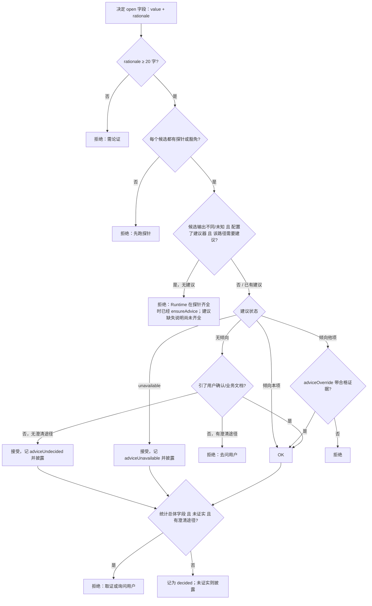
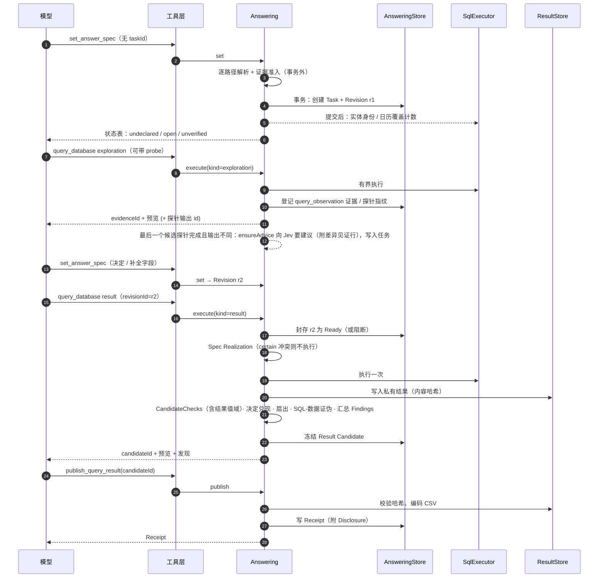
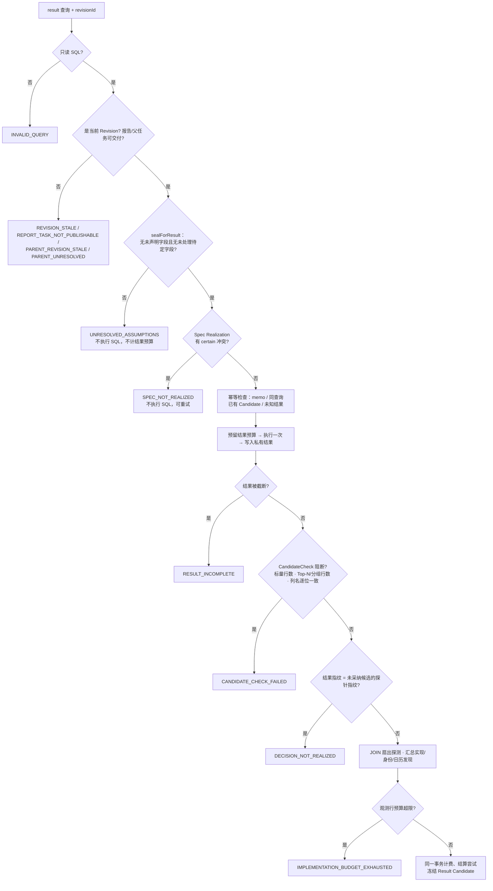
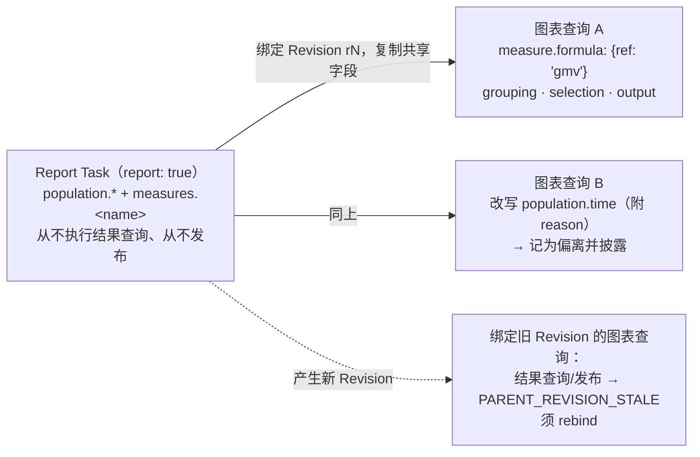

# Answering 模块：设计方法论、架构与工作原理

> 代码位置：`packages/runtime/src/answering/`（领域与用例）、`packages/runtime/src/tools/answering.ts`（模型工具层）、`packages/runtime/src/adapters/pi-session-answering-store.ts`（会话持久化）、`packages/runtime/src/application/session-runtime.ts`（组合根）。
>
> 相关决策：ADR-0003（检测告知而非裁决）、ADR-0004（Runtime 持有状态转移与证据准入）、ADR-0005（探针与决定兑现）、ADR-0006（单一决定动作、由运行时判定是否已证实）、ADR-0007（Answer Spec 字段树）、ADR-0009（报告任务）、ADR-0010（看板刷新）。术语以 `CONTEXT.md` 为准。

---

## 1. 模块定位

Answering 是 Data Agent 中**数据库问答的查询保障（Query Assurance）核心**。模型可以自由编写 SQL，但一条结果要交付给用户，必须经过 Answering：

1. 先把"用户要的是什么答案"写成一份带版本的 **Answer Spec**（字段树）；
2. 探索查询只产生**观测证据**，不能直接交付；
3. 结果查询必须绑定一个**已封存（Ready）的 Revision**，并通过实现核验与结果检查，冻结为不可变的 **Result Candidate**；
4. 只有 Candidate 能被**发布**为 **Publication Receipt**，发布时附上所有未被证实的口径与检测发现（**Disclosure**）。

一句话概括：**模型负责提议与实现，Runtime 负责状态、证据资格、完整性与披露。**

Answering 对外只暴露五个用例（由 `architecture.test.ts` 固定）：

| 用例 | 作用 | 主要实现文件 |
| --- | --- | --- |
| `set` | 按路径写 Answer Spec 字段；无 `taskId` 时创建 Query Task | `revision.ts` |
| `execute` | 执行探索查询（含探针）或一次最终结果查询 | `exploration.ts`、`result-execution.ts` |
| `publish` | 发布当前 Revision 的不可变 Candidate | `publication.ts` |
| `refresh` | 重新执行已发布结果的同一查询，生成新 Receipt | `refresh.ts` |
| `inspect` | 只读查看 Query Task 的投影 | `answering-store.ts` |

---

## 2. 设计方法论

Answering 的设计不是从"怎样验证 SQL 正确"出发，而是从 Spider2 多轮评测暴露的失败模式反推出来的。以下原则贯穿全部代码。

### 2.1 职责分离：模型提议，Runtime 转移

早期设计中，模型同时是 Spec 的**提议者、证据提供者和处置者**——它能自己造出"用户确认"、引用无引文的题面句柄"证明"任意假设，省略某个未决项就能让它消失（ADR-0004 背景）。这只能形成自洽检查，发现不了首因误读。

因此：

- 模型只提交**对某个字段路径的写入**（Field Write），Runtime 从当前 Revision 复制出下一个 Revision，逐路径应用；未提及的字段原样保留，**没有任何东西会因为省略而离开 Revision**。
- 已有状态的字段只能通过**带理由的改写**（Field Rewrite）改变，理由进入审计记录；决定一个待定字段是唯一不需要 `reason` 的改变。
- 证据由 Runtime **准入**：文本证据必须带引文，并在受信来源中逐字找到；观测证据只能由 Runtime 在执行探索查询时登记。
- 字段的依据是"有证据"还是"假定"，由 Runtime 判定，模型无法自报（ADR-0006）。

### 2.2 Spec 管语义，SQL 管实现

Answer Spec 回答"答案是什么意思"，SQL 回答"在这个数据库里怎么算出来"。两者各自被检查：

- Spec 侧：必要性规则保证该表态的字段都有状态；待定字段必须经探针与比较后才能决定。
- SQL 侧：**Spec Realization** 只读封存字段和 SQL 文本（不读对话），判断 SQL 是否*可能*实现这些字段，不判断语义对错。
- 结果侧：**Decision Realization** 用结果指纹检查，最终结果没有复现某个*未被采纳*候选的输出。

### 2.3 检测告知，不裁决（ADR-0003）

检测器能可靠描述结构性观测，却未必能证明唯一的业务口径。把未校准、不可判定的检测直接变成阻断，既减少可交付样本，也阻止后续校准。所以：

- 检测与动作解耦。绝大多数检测只产生 Finding / Coverage，随结果**披露**。
- **硬阻断只保留在"必然错误"或"完整性破坏"上**：字段未声明或仍待定、SQL 在结构上不可能实现封存字段、结果形状必然得零分、Candidate 身份或内容不一致、过期 Revision 等。
- `unavailable`、`unknown`、`not_applicable` 永远不会被静默当作 `clear`。

### 2.4 证据有权威顺序，且按"层"取用

证据权威顺序（`CONTEXT.md`）：用户澄清 > 已审核业务定义 > 任务文档 > 题面原文 > schema 事实 > 观测数据 > 模型推断。评测 Gold 永远不是运行时证据。

字段按路径分为两层，每层只接受能回答该层问题的证据：

| 层 | 字段 | 可证实它的证据 |
| --- | --- | --- |
| 语义层（用户的意思） | 除下列三项外的全部字段 | `user_confirmation`、`reviewed_definition`、`task_document`、`request_wording` |
| 物理层（这个库里如何实现） | `population.source`、`population.timeField`、`population.joinMultiplicity` | `reviewed_definition`、`schema_fact`、`query_observation` |

观测数据**永远不能证实业务含义**；引文核验只证明"原文里有这句话"，不证明它支持该命题——这一判断留在模型的决定与理由里，并随结果披露（咨询性的 SpecFeedback 已于 2026-10-30 删除，见 ADR-0003 修订）。

### 2.5 如实披露代替伪批准

Answering 不产出"已批准/已验证正确"这样的结论。发布记录里有的是：

- 哪些字段是**假定**的、哪些待定字段是**未经证实地决定**的；
- 比较建议不可用或无法区分时的决定；
- 图表查询对报告共享口径的**偏离**；
- JOIN 扇出、实现冲突、实体身份、日历缺期、结果值域、SQL-数据证伪等检测发现。

"放行"不是正确性证明，Disclosure 是记录，不是豁免。

### 2.6 能由 Runtime 推导的，不让模型声明

- **是否已证实**：看所引证据是否对该字段合格。
- **两个候选是否等价**：看探针结果指纹是否相同；全部相同的待定字段自动视为已处理，模型没有"声明等价"的写法。
- **哪些字段必须声明**：由其他字段的值（公式中出现的 `op`、来源表个数、是否有选取）和数据（日历缺期）推出。
- **字段属于哪一层、是否影响统计总体**：由路径决定。

每少一个模型可写的声明，就少一种自我认证的途径和一类调用失败。

### 2.7 不可变、可追溯、幂等

- Result Candidate 一经冻结不再改变；发布**从不重跑 SQL**，只读取 ResultStore 中按内容哈希校验过的同一份私有结果。
- 每个 Receipt 绑定 `taskId / revisionId / candidateId / resultRef / contentHash`，可追溯到具体的 SQL 与口径版本。
- 结果查询按 Pi Invocation memo 与查询身份去重；外部执行结果未知时**不重试**，而是报告 `execution_outcome_unknown`。

### 2.8 有界与可校准

- 每个 Query Task 有预算：Revision、探索、结果、观测行数与墙钟时间，探针单独计数。修订与委派不会重置预算。
- 每条阻断/披露规则都附规则版本号，并要求在历史运行上**回放校准**后才能加入阻断（例如 Spec Realization 中"声明来源表未被读取"因在 5 道正确题上触发，只能作为披露项）。

---

## 3. 架构

### 3.1 分层框架图



要点：

- **门面薄、用例深**。`InMemoryAnswering` 只做上下文校验和调用级去重（同一 invocation 的重复调用复用同一个 Promise；等价的结果查询即便换了 invocation id 也合并）；状态逻辑全部在用例模块中。
- **领域规则是纯函数**。`field-transition.ts`、`qualification.ts`、`realization-check.ts` 等不做 I/O，便于单测与回放校准。
- **I/O 都经端口**。存储、结果、SQL 执行、受信文本来源、建议记录、Jev 评估器都由组合根注入，Answering 不感知 Pi、HTTP 或具体数据库。
- **事务短、SQL 在事务外**。每个用例在 `store.transact` 内读写状态，SQL 执行、证据准入、Jev 调用都在事务之外进行，事务之间用版本号（当前 Revision）做乐观检查。

### 3.2 文件地图

| 类别 | 文件 | 职责 |
| --- | --- | --- |
| 入口 | `public.ts` | 模块对领域调用方的唯一导出面；`verify:architecture` 禁止 `answering/` 以外的生产代码导入其他内部文件 |
| | `storage.ts` | 只供组合根（`application/`）与存储适配器（`adapters/`）导入的存储实现入口 |
| | `actions.ts` | 领域消息里的下一步标记（探索、澄清、重新绑定）；工具层把它渲染成工具名与调用样例，领域代码不出现工具名或 HTTP 路由 |
| | `service.ts` | `Answering` 接口与 `InMemoryAnswering` 门面，解析配置为 `AnsweringDeps` |
| | `deps.ts` | 用例模块共享的已解析依赖 |
| 领域模型 | `model.ts` | 汇总导出（barrel）：`ids.ts` 品牌化 ID、`records.ts` 存储记录、`view-types.ts` 返回视图、`commands.ts` 用例输入与只读 SQL 判定、内容哈希 |
| | `fields.ts` | 字段树路径、值类型与解析、度量表达式、必要性规则；`FIELD_REGISTRY` 集中每条路径的层、是否共享、是否受统计总体规则约束、是否需要建议；`FieldValues` 把每条路径映射到精确值类型，`settledField(fields, path)`（`support.ts`）是从记录到值类型的唯一解码点 |
| | `field-transition.ts` | 字段写入解析、证据资格、状态转移、决定治理、报告继承覆盖 |
| | `qualification.ts` | 未声明/待定/未证实字段计算、`sealForResult` |
| | `evidence-admission.ts` | 引文逐字核验与证据准入 |
| 用例 | `revision.ts` | `set`：创建任务、写字段、产生 Revision |
| | `exploration.ts` | 探索查询、探针记录、观测证据登记 |
| | `result-execution.ts` | 结果查询全流程、Candidate 冻结 |
| | `publication.ts` | Disclosure 组装、发布 Receipt |
| | `refresh.ts` | 已发布结果的刷新 |
| | `report.ts` | 报告任务共享字段与可交付性断言 |
| 检查 | `realization-check.ts` | Spec Realization（SQL 文本 vs 封存字段） |
| | `probes.ts`、`result-fingerprint.ts` | 探针汇总、等价推导、决定兑现冲突 |
| | `candidate-checks.ts` | 结果完整性、形状、身份 |
| | `fanout-check.ts`、`fanout-execution.ts` | 有界 JOIN 扇出探测 |
| | `entity-identity.ts`、`calendar-coverage.ts`、`data-checks-execution.ts` | Revision 提交后的数据事实检测 |
| | `result-domain.ts` | 结果值域检查（count 为负/小数、百分比与比值量纲错位、度量列全 NULL），只披露 |
| | `data-falsification.ts` | SQL-数据证伪（LEFT JOIN 退化、日期闭区间截断、空结果字面量不命中），有界探针，只披露 |
| | `probe-diff.ts` | 探针差异见证行：不同候选输出间的少量具体差异行，供 Jev 与 `[PROBE]` 视图 |
| | `sql-lex.ts` | SQL 词法屏蔽（字符串、引号标识符、注释），供只读判定与结构检查复用 |
| | `physical-profile.ts` | 发布结果的列画像 |
| 基础设施 | `answering-store.ts` | 事务存储接口、写时复制的内存实现、快照、访问控制；只存取记录（`readTaskBundle`），不计算投影 |
| | `result-store.ts` | 私有结果对象（内存/文件）、CSV 编码 |
| | `budget.ts` | 预算、尝试记录、Implementation Obstacle |
| | `sql-execution.ts`、`errors.ts` | 执行器接口、错误分类 |
| | `advice.ts`、`advice-execution.ts` | 字段建议记录与 `ensureAdvice`：候选输出都已知且不同时，Runtime 自己向 Jev 要建议并写入任务 |
| | `views.ts` | 模型视图与 `AnswerTaskView` 投影（未声明、待定、等价） |

---

## 4. 核心领域模型

### 4.1 实体关系



| 对象 | 含义 | 关键不变量 |
| --- | --- | --- |
| **Query Task** | 一次数据库问答请求 | 有预算、生命周期 `open → published`；修订会清除 `latestCandidateId` 与 `publicationId` |
| **Answer Revision** | Answer Spec 的一个版本 | `draft` 或 `ready`；只有当前 Revision 能执行结果查询和发布 |
| **Evidence** | 准入后的证据 | 文本证据须带 `verification`；`query_observation` 只由探索登记 |
| **Field Probe** | 某个待定候选作为探针执行的结果指纹 | 每个候选保留最新一次 |
| **Result Candidate** | 冻结的最终结果 | 不可变；`contentHash` 与 ResultStore 对象一致，否则标为 `corrupt` |
| **Publication Receipt** | 交付记录 | 不可变；附 Disclosure、Coverage、扇出与列画像。首次发布每个 Revision 只能一次；刷新在同一 Revision 下追加新 Candidate 与新 Receipt，形成 `refreshes` 链 |

所有 ID 都是品牌化类型（`Id<"TaskId">` 等），由 Answering 内部发放，调用方只能拿到不透明字符串。

### 4.2 Answer Spec 字段树

字段按**计算顺序**组织：先定统计谁（population），再定算什么（measure），然后分组、选取、输出。



可写路径共 16 个，另加报告任务上的 `measures.<name>`（具名度量定义）。

**`measure.formula` 是逐层表达式**，每层写明运算 `op`、计算粒度 `per`、作用对象 `of`（或 `numerator/denominator`、`from/to`）。嵌套顺序即聚合顺序，多于一层时每个内层必须给出 `per`：

```json
{ "op": "avg", "per": "country",
  "of": { "op": "avg", "per": "player",
          "of": { "op": "sum", "per": "match", "of": "runs" } } }
```

`op` 枚举：`count`、`count_distinct`、`sum`、`avg`、`median`、`min`、`max`、`ratio`（a/b）、`percentage`（100·a/b）、`difference`、`change_rate`、`pp_difference`、`cumulative`、`rolling`、`custom`（须附 `description`）。

### 4.3 必要性规则：什么时候必须表态

`fields.ts` 的 `requiredPaths` 与 `calendar-coverage.ts` 一起决定哪些字段必须有状态（"不适用"也是一种状态）：

| 字段 | 必须声明的条件 |
| --- | --- |
| `population.entity/eligibility/conditions/time`、`measure.formula`、`grouping`、`selection`、`output` | 总是 |
| `measure.countGrain` | 公式任一层含 `count`、`count_distinct`、`avg`、`median`、`ratio`、`percentage`、`change_rate` |
| `measure.denominator` | 任一层含 `avg`、`ratio`、`percentage`、`change_rate` |
| `measure.window` | 任一层含 `cumulative`、`rolling` |
| `selection.ties` | `selection` 不是"不适用" |
| `population.joinMultiplicity` | `population.source.tables` 多于一张表 |
| `population.missing` | 日历覆盖检测发现范围内有期间无数据（由数据触发） |

规则检查**表达式的任一层**，而非仅最外层；待定字段的每个候选值都参与判断。报告任务只要求共享的 population 字段。

### 4.4 字段状态机



`specified` 与 `decided` 都带 **Field Basis**：

- `evidence`：所引证据中至少一条对该字段的层合格；
- `assumed`：没有合格证据（包括裸值、`basis:"assumed"`、引了但不合格的证据），**发布时披露**。

模型可用的写法（`FIELD_FORMS`）：

| 写法 | 结果 |
| --- | --- |
| `"n/a"` | 不适用 |
| 裸值 / `{value}` / `{value, basis:"assumed", rationale}` | 假定 |
| `{value, basis:"request", quote}` | 题面逐字引文，核验通过即"有证据" |
| `{value, cite:[{source, quote}]}` | `source` 为 `knowledge:<id>`、`schema:<table.column>`、`clarification:<id>` 或 `message` |
| `{value, evidenceIds}` | 引用 `query_database` 登记的观测证据 |
| `{open:[...]}` | 待定，Runtime 为每个候选发放 `alternativeId` |
| `{value:<候选>, rationale, evidenceIds?, adviceOverride?}` | 决定待定字段 |
| `{notProbeable:{<alternativeId>: reason}}` | 声明某候选无法单独执行 |

### 4.5 决定待定字段的治理（ADR-0005/0006）

`field-transition.ts` 中的 `governDecision` 与 `guardPopulation` 按顺序检查：



统计总体规则（Material Population Decision）作用于 `population.entity`、`population.eligibility`、`population.conditions`：会话有澄清工具时，它们不能由未证实的决定确定，且 `population.eligibility` 不能是假定；无澄清工具（评测、无人值守）时允许，但必须披露。该能力由组合根配置（`populationDecisions`），不由模型声明。

---

## 5. 工作原理

### 5.1 端到端时序



### 5.2 `set`：写字段，产生 Revision

实现于 `revision.ts`：

1. **事务外准备**（`prepareWrites`）：逐路径 `parseFieldWrite` 解析写法与值；对引文做证据准入（`admitEvidence`，向 `EvidenceSource` 读取原文并逐字核验）。单个路径失败只记为该路径 `rejected`，不影响其他路径。
2. **事务内应用**（`applyWrites`）：以当前 Revision 为起点，按调用顺序把每个已准备的写入交给纯函数 `applyFieldWrite`。被拒的写入不改变任何东西，其证据也不登记。
3. **一次调用落一个 Revision**：成功的写入合并为一个新 Revision，只计一次 Revision 预算（创建任务不计）。若没有任何写入成功，不写入、不计费，返回当前 Revision。
4. **提交后的附加检查**（不影响事务结果）：
   - `attachDataChecks`：按 `population.entity/source` 统计行数、去重行数、声明键去重数（最多 3 张表，超过 200 万行跳过去重计数）；按分组粒度与时间范围列出实际有数据的期间。
5. 返回**状态表**：每个字段的状态、值、候选及探针输出、建议；以及 `undeclared`、`open`、`unverified` 与逐路径 `outcomes`。

### 5.3 `execute(exploration)`：探索与探针

实现于 `exploration.ts`：

- 只读 SQL（`isReadOnlySql`：单条、以 SELECT/WITH/EXPLAIN 等开头、无写关键字）。
- 预留一次探索预算后执行，成功时登记一条 Runtime 拥有的 `query_observation` 证据，返回 `evidenceId`。探索结果**永远不会成为 Candidate**。
- 带 `probe: {path, alternativeId}` 时作为某个待定候选的**探针**：读取完整输出（上限 10,000 行）计算 **Result Fingerprint**，记录到 Task 上。探针单独计数（每任务最多 24 次），不消耗探索预算。
- **Result Fingerprint** 忽略列名、列序、行序，数值按两位小数比较，数字文本与数值等同——与评测判分方式一致。指纹相同即"同一个答案"。
- 探索不受任何字段未决的阻断。

### 5.4 `execute(result)`：从封存到 Candidate

实现于 `result-execution.ts`，按顺序：



**Spec Realization 规则**（`spec-realization-v1`）：

| 确定性 | 规则 | 处理 |
| --- | --- | --- |
| certain | 最外层行数上限与 `selection.n` 不同（`strict`） | 阻断 |
| certain | `include_ties` 却以不带 WITH TIES 的行数上限截断 | 阻断 |
| certain | 公式含 `percentage` 或 `pp_difference`，SQL 从未乘 100 | 阻断 |
| likely | 声明的来源表未被读取 | 披露 |
| likely | `count_distinct` 而 SQL 无 DISTINCT | 披露 |
| likely | SQL 聚合层数少于公式嵌套层数 | 披露 |
| likely | 声明的日历粒度未被派生 | 披露 |
| likely | `include_ties` 只用 ROW_NUMBER | 披露 |

规则读不懂的字段记为 `not_determinable`，**不记为已实现**。

**决定兑现**（Decision Realization）只看"是否复现了未被采纳候选的输出"，不要求等于被采纳候选的探针输出——其他字段可能在探针之后改过，只有与被拒候选相同才是确凿冲突。

**JOIN 扇出**（`answering-fanout-v1`）：对含 COUNT/SUM 且有 JOIN 的查询，最多选 2 个目标、输入不超过 5 万行，比较来源关系的行数/键去重数与连接后的键去重数，得出放大倍数。结果只作为 Finding 披露，是"有界的指标复制观测"，不是业务裁决。

### 5.5 `publish`：组装披露，生成 Receipt

实现于 `publication.ts`：

1. 事务内校验：Candidate 存在且 `ready`、属于当前且已封存的 Revision；同一 Revision 已有另一个 Candidate 的 Receipt 时拒绝（`PUBLICATION_ALREADY_EXISTS`）；按 `requestId` 或 Candidate 找到已有 Receipt 时直接返回（重放安全）。
2. 构造内部的 `PublicationPermit`（模型与 HTTP 调用方都无法构造），从 ResultStore 打开私有结果并核对内容哈希；不一致则把 Candidate 标为 `corrupt`。
3. 选择格式：`auto` 时 ≤10 行内联、否则 CSV；发布物总是 CSV，`inline` 只决定是否同时回显行。
4. `composeDisclosure` 汇总：假定字段、未证实决定、建议不可用/无倾向的决定、报告偏离、父口径已被取代（刷新时）、扇出、实现冲突、实体身份、日历缺期、结果值域、SQL-数据证伪。没有任何项时不生成 Disclosure。`refresh` 复用同一个 Receipt 构建函数，保留原结果中与行无关的实现冲突、实体身份与日历缺期，并对新行重新运行值域与证伪检查。
5. 生成物理列画像（类型、空值数、去重数、数值范围），写 Receipt，任务 `lifecycle` 变为 `published`。提交前再次确认 Revision 未变、报告任务仍可交付。

### 5.6 `refresh`：已发布数据的再执行（ADR-0010）

`refresh({receiptId})` 读取原 Receipt 的 Candidate 与 Revision，**重新执行同一条 SQL**，重新做 CandidateCheck、扇出与披露、列画像，先冻结一个**新的 Result Candidate**（同一 Revision、同一 SQL、新的内容哈希），再签发指向它、带 `refreshes: <原 receiptId>` 的新 Receipt。因此 Receipt → Candidate → 私有结果的哈希一致性在刷新后依然成立。它不改 Answer Spec、不接受新 SQL 或参数、原 Receipt 不变、不计入任务的编写预算；同一 `requestId` 幂等。调用方是看板的 `dashboard.refresh` 协议（`facets/dashboard-refresh.ts`），页面提供的 SQL、Receipt id 或行数据都不被采信。

### 5.7 报告任务与图表查询（ADR-0009）



- 共享字段是全部 `population.*` 与 `measures.<name>`；图表查询用 `measure.formula: {ref}` 引用具名度量，连带复制其 `countGrain/denominator/window`。
- 图表查询改共享字段必须附 `reason`，记为 **Deviation** 并披露。
- 报告任务上未处理的共享字段阻断所有图表查询的结果与发布；探索不受影响。
- 刷新时若父 Revision 已被取代，新 Receipt 的 Disclosure 标明"图仍按修改前的口径计算"。

---

## 6. 阻断与披露一览

| 类别 | 触发条件 | 错误码 / 去向 | 是否执行 SQL |
| --- | --- | --- | --- |
| 上下文/权限 | 缺 principal/session/invocation，或跨会话访问 | `ANSWERING_CONTEXT_INVALID` 等 | 否 |
| 非只读 SQL | 多语句或写操作 | `INVALID_QUERY` | 否 |
| 字段写入 | 未知路径、值格式错、改写缺 reason、统计总体缺证据、决定治理不满足 | 该路径 `rejected`（其他路径照常） | — |
| 证据 | 引文在受信来源中找不到、引用未知证据 | `EVIDENCE_REJECTED` | — |
| 封存 | 有未声明字段或未处理待定字段 | `UNRESOLVED_ASSUMPTIONS` | 否 |
| 实现核验 | certain 级 Spec Realization 冲突 | `SPEC_NOT_REALIZED` | 否 |
| 过期 | Revision 已变；父 Revision 已变或未处理 | `REVISION_STALE`、`PARENT_REVISION_STALE`、`PARENT_UNRESOLVED` | 否 |
| 结果完整性 | 结果被截断 | `RESULT_INCOMPLETE` | 是 |
| 结果形状 | 标量非 1 行、Top-N/分组行数不符、列名不逐位一致 | `CANDIDATE_CHECK_FAILED` | 是 |
| 决定兑现 | 结果复现未采纳候选的输出 | `DECISION_NOT_REALIZED` | 是 |
| 预算 | 任一预算耗尽 | `IMPLEMENTATION_BUDGET_EXHAUSTED` | 视阶段 |
| 外部结果未知 | 上次执行没有可安全重放的结果 | `RESULT_EXECUTION_OUTCOME_UNKNOWN`（不重试） | 未知 |
| 发布完整性 | 内容哈希不符、Candidate 损坏、同 Revision 已发布他项 | `RESULT_INTEGRITY_MISMATCH`、`PUBLICATION_ALREADY_EXISTS`、`PUBLICATION_STALE` | 否 |
| **只披露** | 假定字段、未证实决定、likely 级实现冲突、扇出、键不唯一/重复行、日历缺期、结果值域、SQL-数据证伪、报告偏离 | Receipt 的 `disclosure` / `coverage` | — |

每个阻断都以 **Implementation Obstacle** 形式返回：`kind`（`technical_failure`、`mapping_insufficient`、`business_judgment_required`、`budget_exhausted`、`execution_outcome_unknown`）、是否需要外层决定、是否可重试、SQL 是否已执行、执行结果，以及本任务的尝试记录。报错把修正方法放在首行（例如同时列出声明列与实际列）。

---

## 7. 一致性、幂等与故障处理

| 机制 | 位置 | 作用 |
| --- | --- | --- |
| 调用级合并 | `service.ts` | 同一 `sessionId:invocationId` 复用同一 Promise；签名不同报幂等冲突；等价结果查询（同 task/revision/SQL）合并执行 |
| Pi Invocation memo | `result-execution.ts`、`exploration.ts` | 执行前写 `started`，成功后写 `settled`（只记 resultRef 与哈希，行数据不进会话状态）；重放时见 `started` 即报告结果未知，不重跑 |
| 查询身份去重 | `findCandidateByInvocation` / `findCandidateByQuery` | 同一 Revision 同一 SQL 只产生一个 Candidate |
| 提交丢失恢复 | `result-execution.ts`、`publication.ts` | 提交响应丢失时按查询身份或 requestId 找回已持久化的记录 |
| 内容哈希 | ResultStore | Candidate 与 Receipt 只信任哈希一致的私有结果，不一致即标记 `corrupt` |
| 短事务 + 乐观检查 | 各用例 | SQL、准入、Jev 都在事务外；提交前再次确认当前 Revision 未变 |
| 数据库不可用 | `budget.ts` 的 `throwExecutionFailure` | 记为 `DATABASE_UNAVAILABLE` 并结束操作，不作为让 Agent 绕行的障碍 |
| 快照版本 | `answering-store.ts` | 持久化快照带 `version: 2`，其他版本不读取 |

---

## 8. 预算

默认策略 `answering-dual-loop-v1`（`budget.ts`），按 Query Task 计：

| 项 | 默认值 | 说明 |
| --- | --- | --- |
| `maxRevisions` | 8 | 创建任务不计；一次 `set` 调用计一次 |
| `maxExplorationAttempts` | 16 | 探针不计入 |
| 探针 | 24 | `MAX_FIELD_PROBES`，单独计数 |
| `maxResultAttempts` | 8 | 被封存/实现核验阻断的尝试不计 |
| `maxObservedRows` | 200,000 | 探索与结果累计观测行 |
| `maxElapsedMs` | 15 分钟 | 从任务创建起算的墙钟时间 |

报告任务与每个图表查询各自独立计费；刷新不计入编写预算。

---

## 9. 模型工具映射

`tools/answering.ts` 把用例包装为模型工具，并把视图渲染为模型可读文本（如 `[PROBE]`、`[FANOUT_CHECK]` 段落）：

| 工具 | 调用 | 说明 |
| --- | --- | --- |
| `set_answer_spec` | `set` | 唯一的 Spec 写入工具；支持 `report: true`、`parentTaskId`、`rebind: true` |
| `query_database` | `execute` | `kind=exploration`（可带 `probe`）或 `kind=result`（须带当前 `revisionId`） |
| `publish_query_result` / `export_query` | `publish` | 发布不可变 Candidate，从不执行 SQL |
| `inspect_answer` | `inspect` | 只读投影 |
| `begin_query_task` | `set`（中性） | 仅评测消融模式：不写语义 Spec，但保留任务/Candidate/Receipt 身份 |

---

## 10. 组合根配置

`application/session-runtime.ts` 构造 `InMemoryAnswering`，关键开关：

| 选项 | 取值来源 | 影响 |
| --- | --- | --- |
| `store` | Pi 会话存储（`PiSessionAnsweringStore`） | 状态随会话持久化 |
| `semanticQualificationMode` | `semanticSpecMode === "disabled"` 时为 `bypassed` | 评测消融：跳过封存资格检查，保留身份链 |
| `fieldProbes` | 语义 Spec 启用时为 `true` | 开启"先探针后决定"与决定兑现检查 |
| `fieldAdvice` | 配置了 Jev 建议器且开启探针时 | 候选输出不同时由 `ensureAdvice` 自动取建议，决定须参考它 |
| `formatPublicRef` | Session Host 注入 `/api/runtime/publications/...` | Receipt 的公开引用；默认是不透明句柄 `publication:<id>` |
| `entityIdentity` / `dataFalsification` | 可选 | 实体身份计数的行数阈值与超时；证伪探针的数量与超时 |
| `populationDecisions` | 关闭澄清工具时为 `allow_disclosed` | 统计总体能否以未证实决定确定 |
| `specFeedback` | 配置了 `specAlignmentAssessor` 时开启 | 提交后的咨询性对齐反馈（默认 15s 超时、64KB 输入上限） |
| `evidenceSource` | 用户消息、澄清回答、授权知识文档 | 未配置时文本证据一律无法核验 |
| `fanout` | 方言与 schema 由执行器懒加载 | JOIN 扇出探测 |
| `budgetPolicy`、`maxResultRows` | 默认策略、10 万行 | 预算与结果上限 |

---

## 11. 扩展指引

- **新增阻断规则**：先在已有运行上回放，证明它只在必然错误的情况下触发；否则作为 `likely` / Finding 只披露。规则须带版本号，并在 Coverage 中区分 `clear`、`finding`、`not_applicable`、`unknown`。
- **新增字段或路径**：改 `fields.ts` 的路径、值解析、层与必要性规则，在 `FIELD_REGISTRY` 登记该路径的元数据，并同步 `answer-fields` Skill；跨字段的不确定性优先放在已有节点的待定候选里，而不是恢复交叉引用。
- **新增证据来源**：实现 `EvidenceSource` 端口；文档的权威等级由组合根配置，不取自模型或文档内容。
- **新增检测**：放在事务外执行，结果附到 Revision 或 Candidate 上，通过 `composeDisclosure` 进入 Receipt；不要在检测中修改字段状态。
- **公开接口**：`Answering` 的方法清单由架构测试固定，新增用例需要 ADR。

---

## 12. 术语速查

| 术语 | 含义 |
| --- | --- |
| Query Task | 一次数据库问答请求，含版本链、候选、发布状态 |
| Answer Spec / Revision | 按字段树书写的答案口径 / 它的一个版本 |
| Field Basis | 字段依据：`evidence` 或 `assumed`，由 Runtime 判定 |
| Probe | 把待定字段的一个候选作为探索执行，记录结果指纹 |
| Result Fingerprint | 忽略列名、列序、行序、两位小数比较的输出身份 |
| Spec Realization | 只读封存字段与 SQL 文本的实现核验 |
| Result Candidate | 冻结的最终结果，唯一可发布的对象 |
| Publication Receipt | 交付记录，附 Disclosure、Coverage、列画像 |
| Disclosure | 发布时仍未证实或被检测到的事项的记录，不是批准 |
| Implementation Obstacle | 内循环的分类障碍，告诉模型该改 SQL、改 Spec 还是需要外层决定 |
| Report Task / Chart Query | 承载共享口径的父任务 / 绑定其某个 Revision 的子查询 |
