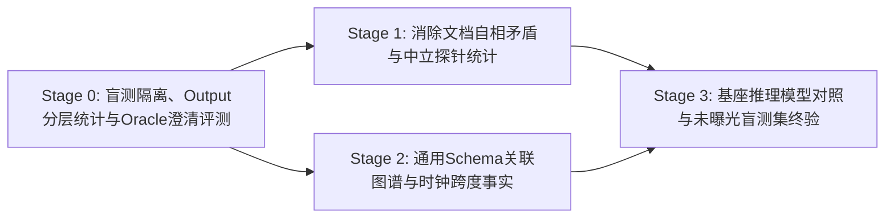

# Answering 模块准确率持续爬山行动计划（去先验污染版）

> 基准状态：`develop` `6a3ea2e`（Phase 1–5 已合入）+ PR #282（移除 Jev 比较建议器）
> 历史参考：`answering-plan-ab-treatment-001`（Spider2-lite 50 题，`deepseek-flash`，`--disable-clarification`，原始得分 **36 / 50 = 72.0%**）
> 关联文档：[answering_module_improvement_plan.md](./answering_module_improvement_plan.md)、[answering-falsification-calibration.md](./answering-falsification-calibration.md)、[ADR-0003](./adr/0003-detect-inform-never-block.md)、[ADR-0005](./adr/0005-choice-realization-and-decision-points.md)、[ADR-0007](./adr/0007-answer-spec-as-one-field-vocabulary.md)

---

## 一、现状复盘与方法论纠偏

### 1.1 已曝光 50 题的失分构成（仅作机制定性，不再作泛化证明集）

对 `answering-plan-ab-treatment-001` 未通过的 14 题核对后，失分由四类完全不同性质的问题叠加而成：

| 类别 | 题数（占 50 题） | 性质判定 | 处理策略 |
| --- | --- | --- | --- |
| **评测集 Gold 缺陷** | **4 题（8%）** | Gold 与题面显式冲突（双盲已裁定） | **统计剔除**：单列 `Clean Accuracy`，绝不迎合错解 |
| **`output` 输出格式/列契约差异** | **2 题（4%）** | 核心实体与目标数值已算对，仅辅助列增减或未规定分类标签字面量不同 | **仅统计区分，不做重点修正**：在评测报表中单列 `Output-Shape Mismatch`，不在 Runtime 堆砌列形态特判规则 |
| **真歧义题在禁澄清下二选一蒙错** | **4 题（8%）** | 题面本身允许两种读法且无业务文档；模型已打开 `open` 且探针已包含正解（`Oracle@Probe = 1`），仅在 `--disable-clarification` 下自主二选一落败 | **改评测机制，禁塞口径先验**：严禁把出题人偏好写进 Prompt；在禁澄清下考核 `Oracle@Probe`，并通过受控 `Oracle Clarifier` 度量真实交互闭环 |
| **通用探索遗漏与复杂算式推理失误** | **4 题（8%）** | 多表关联探索漏表、静态历史库误用实时 `NOW()`、复杂日期算术/窗口推理越过轻量模型上限 | **唯一正当的工程与模型攻坚对象**：通过通用元数据底座与基座推理能力升级解决 |

### 1.2 三条反作弊（Anti-Overfitting）铁律

1. **物理隔离盲测集（Blind Holdout Firewall）**：上述 50 题因已人工查看过错题轨迹与 Gold，正式降级为**已曝光回归诊断集**。另外锁定一批从未查看过题面、轨迹与 Gold 的独立题目作为 **Blind Holdout**；开发迭代期间严禁查看盲测集单题明细，只允许读取聚合指标。
2. **零口径先验污染（Zero Benchmark-Prior Leakage）**：严禁向 [`.agents/skills/spec/SKILL.md`](../.agents/skills/spec/SKILL.md)、[`semantic_guide.md`](../.agents/knowledge/doc/semantic_guide.md) 或 Runtime 注入任何偏向特定出题人习惯的业务默认规则（如默认选某类时间列、默认合并某类字符串变体）。文档层仅允许修复**自身逻辑自相矛盾**。
3. **不针对单题 SQL 形态打补丁（No Patchwork Heuristics）**：不针对 `output` 列契约或特定题目算式编写正则/AST 特判；所有 Runtime 能力必须是与具体题库无关的**客观物理事实供给**，且遵循 [ADR-0003](./adr/0003-detect-inform-never-block.md) 离线校准与 Keep-or-Revert（零净收益即回滚）纪律。

---

## 二、多维评测指标体系（立尺子）

为如实反映系统能力并隔离评测噪声，评测管线统一输出以下两组指标：

### 2.1 单轮自主模式（`--disable-clarification`）

| 指标 | 定义 | 作用 |
| --- | --- | --- |
| **`Raw Exec Accuracy`** | 官方 `evaluate.py` 原始严格匹配率 | 对齐外部公开基准口径 |
| **`Clean Exec Accuracy`** | 剔除已裁定 Gold 缺陷题后的严格匹配率 | 消除坏题天花板干扰 |
| **`Core Semantic Accuracy`** | 进一步将 **`Output-Shape Mismatch`**（实体与度量值完全命中 Gold，仅增减辅助列或自造标签名不同）单列统计后的核心语义正确率 | 按要求在统计中区分 `output` 类误差，避免误判核心计算能力 |
| **`Oracle@Probe`** | 待定（`open`）字段的所有探针候选中，至少一个候选复现 Gold 的比例 | 度量无澄清条件下“诚实识别歧义并覆盖真解”的真实能力上限 |

### 2.2 受控交互澄清模式（`--oracle-clarifier`）

| 指标 | 定义 | 作用 |
| --- | --- | --- |
| **`Interactive Exec Accuracy`** | 开启无状态模拟业务方回答 `ask_user_clarification` 后的端到端严格匹配率 | 度量 `open → probe → [WITNESS] → 澄清 → 交付` 真实产品闭环的准确率（零先验泄漏） |
| **`Clarification Precision`** | 触发澄清的问题确实命中真实业务分叉点（探针结果不同且题面未规定）的比例 | 防止模型通过无脑乱问刷高交互正确率 |

---

## 三、分阶段行动计划与验收条件

---

### Stage 0：盲测隔离、分层统计与受控澄清评测基座（预计 1–2 天）

> **目标**：先建好不泄题、可区分 `output` 误差、能测真实澄清闭环的评测尺子，再动任何业务或运行时代码。

| 任务 | 具体动作 | 涉及文件 |
| --- | --- | --- |
| **T0.1 锁定未曝光盲测集与 `--blind` 护栏** | 1. 已曝光 50 题固定为 `regression-exposed-50-ids.txt`（仅做回归与诊断）； 2. 从未查看过 trace/Gold 的剩余 Spider2 题中抽样锁定 `blind-holdout-ids.txt`； 3. 评测报告脚本新增 `--blind` 模式：仅输出聚合指标表，禁止在终端或摘要 Markdown 打印盲测集错题题面、提交 SQL 与 Gold 对比。 | 新增 `evaluations/spider2/regression-exposed-50-ids.txt` 新增 `evaluations/spider2/blind-holdout-ids.txt` [`evaluations/spider2/evaluation.mjs`](../evaluations/spider2/evaluation.mjs) |
| **T0.2 新增 `Output-Shape Mismatch` 分层统计与 `Oracle@Probe` 汇总** | 在评测评分后处理中新增纯统计分类器（**不改动 Runtime**）： • 当官方 `exec_result = 0` 时，自动检测提交 CSV 是否在“列子集投影”或“忽略未锚定常量字符串标签列”下与 Gold 数值/实体 100% 吻合；若是，在报表中归入 `output_shape_mismatch` 单列统计，并据此计算 `Core Semantic Accuracy`； • 整合探针重放结果，常规输出 `Oracle@Probe`。 | [`evaluations/spider2/evaluation.mjs`](../evaluations/spider2/evaluation.mjs) [`evaluations/spider2/label_probe_alternatives.py`](../evaluations/spider2/label_probe_alternatives.py) |
| **T0.3 实现无状态受控 `Oracle Clarifier`（模拟业务方）** | 在评测器（仅测试侧，不进生产包）接入隔离的模拟用户回调： • 仅当被测 Agent 调用 `ask_user_clarification` 给出候选业务选项时触发； • 模拟用户仅依据原题与 Gold 口径用一句纯业务自然语言在候选中作答； • **防作弊硬校验**：若模拟回答包含物理表名、列名、SQL 关键字或公式代码，直接拦截并判该次澄清失败。 | [`evaluations/spider2/run.mjs`](../evaluations/spider2/run.mjs) 新增 `evaluations/spider2/oracle-clarifier.mjs` 新增 `evaluations/spider2/oracle-clarifier.test.mjs` |

**Stage 0 验收条件**：
- [ ] `npm run test:eval:spider2` 全绿，新增单测覆盖：① `output_shape_mismatch` 正反例识别（多/少辅助列、分类标签名不同 vs 真实数值算错）；② `Oracle Clarifier` SQL/列名泄漏拦截器；③ `--blind` 模式下零单题内容输出。
- [ ] 在历史 `answering-plan-ab-treatment-001` 产物上回放新统计脚本，自动区分出 `Raw 36/50`、`Clean 30/40`、`Output-Shape Mismatch 2 题` 及 `Oracle@Probe` 基线。

---

### Stage 1：消除文档自相矛盾与补齐中立客观统计事实（预计 1–2 天）

> **目标**：修复规则文档内部逻辑死锁，并让 `[PROBE]` 提供准确的客观计数事实，全程零业务偏向、零额外 SQL。

| 任务 | 具体动作 | 涉及文件 |
| --- | --- | --- |
| **T1.1 修复 `SKILL.md` 内部整行重复规则冲突** | 修复 [`.agents/skills/spec/SKILL.md`](../.agents/skills/spec/SKILL.md#L125) 第 125 行的逻辑自相矛盾（前句写*“键不唯一时按键去重”*，后句写*“完全重复行除非说明否则按原行计数”*，而整行重复必然导致键不唯一）： • 严格按客观数据结构区分“同键异值（一对多明细）”与“完全重复行（`rows > distinctRows` 且 `distinctRows = distinctKeys`）”； • 明确完全重复行无权威依据时属于未决数据质量歧义，按常规流程设为 `open` 或披露，**不预设偏向去重或不去重**。 | [`.agents/skills/spec/SKILL.md`](../.agents/skills/spec/SKILL.md) |
| **T1.2 `[PROBE]` 补充中立客观基数与空值计数** | 在 [`probe-diff.ts`](../packages/runtime/src/answering/probe-diff.ts) 构造 `ProbeSample` 时顺带统计纯客观物理指标（`totalRows`、各输出列 `NULL` 单元格数，**零额外 SQL**），在 [`tools/answering.ts`](../packages/runtime/src/tools/answering.ts) 的 `[PROBE]` 视图中立展示，消除模型手数样本行导致的事实性算术错误；严禁附加任何推荐或排除暗示。 | [`packages/runtime/src/answering/probe-diff.ts`](../packages/runtime/src/answering/probe-diff.ts) [`packages/runtime/src/answering/view-types.ts`](../packages/runtime/src/answering/view-types.ts) [`packages/runtime/src/tools/answering.ts`](../packages/runtime/src/tools/answering.ts) |

**Stage 1 验收条件**：
- [ ] `probe-diff` 与 `tools/answering` 单测覆盖 `totalRows`（含超 200 行样本截断场景）与列级 `NULL` 计数准确性。
- [ ] 代码审查确认 `SKILL.md` 与 `tools/answering.ts` 变更中不包含任何数据集特化词汇或默认业务口径倾向。

---

### Stage 2：通用数据库元数据底座与物理时钟事实补齐（预计 2–3 天）

> **目标**：只增强对任何未知数据库都成立的**纯物理结构事实**供给（外键关联拓扑、系统时钟与数据最大时间的物理跨度），不引入任何题面词面匹配启发式。

| 任务 | 具体动作 | 涉及文件 |
| --- | --- | --- |
| **T2.1 暴露数据库原生外键与共享键拓扑摘要** | 检查并增强数据库 Schema 元数据采集与 `SchemaProfile`：在会话读取库结构时，直接提取数据库原生外键关系（如 SQLite `PRAGMA foreign_key_list` / 信息模式外键）及主键名精确匹配的候选关联边，使探索代理在小步探索中一眼看清全库表连接拓扑，减少孤立单表盲查（纯 Schema 结构事实，与具体问题无关）。 | [`packages/runtime/src/answering/schema-profile.ts`](../packages/runtime/src/answering/schema-profile.ts) 及对应数据库 Schema 适配层 |
| **T2.2 实时系统时钟与历史静态库跨度事实提示（`temporal_anchor_drift`）** | 1. 在 [`sql-digest.ts`](../packages/runtime/src/answering/sql-digest.ts) 识别多方言当前系统时间调用（`CURRENT_DATE`、`CURRENT_TIMESTAMP`、`NOW()`、`DATE('now')`、`DATETIME('now')`、`SYSDATE`）； 2. 在 [`data-falsification.ts`](../packages/runtime/src/answering/data-falsification.ts) 增加纯物理事实规则 `temporal_anchor_drift`：当 SQL 读取当前系统时间，而 `SchemaProfile` 测得所读表全部时间列最大值早于系统当前时间超过 365 天时，产出非阻断 `Finding`，客观列出“系统当前日期”与“表内最大日期”，交由模型自行核对时间基准； 3. 经 [`falsification-calibration.mjs`](../evaluations/spider2/falsification-calibration.mjs) 在历史开发集与留出集做离线误报校准。 | [`packages/runtime/src/answering/sql-digest.ts`](../packages/runtime/src/answering/sql-digest.ts) [`packages/runtime/src/answering/data-falsification.ts`](../packages/runtime/src/answering/data-falsification.ts) [`evaluations/spider2/falsification-calibration.mjs`](../evaluations/spider2/falsification-calibration.mjs) |

**Stage 2 验收条件**：
- [ ] 单测覆盖外键拓扑提取、多方言系统时间函数识别、历史静态表与近实时表的边界判定（无法判定时返回 `unknown`，绝不静默标 `clear`）。
- [ ] 离线校准报告证明 `temporal_anchor_drift` 在历史正确题留出集上误报率 ≤ 1%（保持非阻断告知，符合 [ADR-0003](./adr/0003-detect-inform-never-block.md)）。

---

### Stage 3：基座推理能力对照与未曝光盲测集终验（预计 2 天）

> **目标**：用严格受控实验分离“架构底座收益”与“基座模型推理收益”，并在从未接触过的 **Blind Holdout** 上完成一次性真实验收。

| 任务 | 具体动作 | 涉及文件 |
| --- | --- | --- |
| **T3.1 基座推理模型档位对照实验** | 在已曝光回归集（50 题，`k=3`）上保持代码完全一致，对比 `deepseek-flash` 与强推理档模型（如 `deepseek-reasoner` 或同级模型）在 **禁澄清自主模式** 与 **`Oracle Clarifier` 交互模式** 下的表现，量化复杂算式推理（多段日期差、累计窗口等）对模型档位的敏感度；仅在净增益显著时采用强推理配置或按阶段路由。 | [`evaluations/spider2/run.mjs`](../evaluations/spider2/run.mjs) `docs/answering-model-scaling-ab.md` |
| **T3.2 回归消融与 Blind Holdout 一次性盲测验收** | 1. 在 `regression-exposed-50-ids.txt` 验证无劣化，并对 Stage 1–2 子项做消融检查，回滚任何零增益改动； 2. 在 `blind-holdout-ids.txt`（`--blind` 模式）上对“基线代码”与“新代码”执行一次性配对盲测（同时跑 `--disable-clarification` 与 `--oracle-clarifier` 两档）； 3. 输出正式盲测报告并向 `develop` 发起 PR。 | `docs/answering-blind-holdout-report.md` `evaluations/spider2/answering-blind-holdout-v1.json` |

**Stage 3 最终验收条件**：
- [ ] 工程静态门禁与全量测试通过：`npm run verify:architecture`、`npm run build`、`npm run typecheck`、`npm run typecheck:negative --workspace=@data-agent/runtime`、`npm test`、`npm run test:eval:spider2`。
- [ ] **零污染证明**：Git diff 复核确认未引入任何针对特定测试题的硬编码词表、口径偏向规则或 `output` 特判逻辑，盲测集 ID 在开发提交历史中零单题查看记录。
- [ ] **Blind Holdout 盲测达标**：
  - 自主模式（`--disable-clarification`）：`Clean Exec Accuracy`、`Core Semantic Accuracy`（单列 `Output-Shape Mismatch`）及 `Oracle@Probe` 均不低于基线且取得净正向提升；
  - 交互模式（`--oracle-clarifier`）：端到端 `Interactive Exec Accuracy` 显著高于同代码禁澄清模式（验证 `open → probe → [WITNESS] → 澄清` 产品闭环真实有效）。
